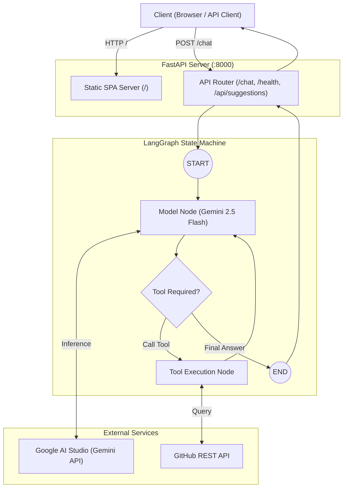

<div align="center">

# PRAMANIX AI 🤖

**Autonomous AI Agent & Study Partner built with LangGraph, FastAPI, and Google Gemini**

[](LICENSE)
[](pyproject.toml)
[](https://fastapi.tiangolo.com)
[](https://github.com/langchain-ai/langgraph)
[](https://aistudio.google.com)
[](https://react.dev)
[](https://vitejs.dev)

<br/>

<p align="center">
  <em>Discover open-source repositories, evaluate software architectures, and accelerate your engineering journey.</em>
</p>

</div>

---

## 🌟 Highlights

Pramanix is an autonomous AI agent engineered specifically for students, software engineers, and curious builders. By combining **Google Gemini** reasoning, **LangGraph** state machine orchestration, and real-time **GitHub API** exploration tools, Pramanix guides users from initial ideas to concrete, high-quality open-source projects.

- **Intelligent Tool-Calling Agent:** LangGraph state machine powered by Google Gemini (`gemini-2.5-flash`), autonomously deciding whether to explain concepts directly or query GitHub tools.
- **Real-Time GitHub Exploration:**
  - `github_search`: Query public repositories ordered by stargazers with topic, language, and license metadata.
  - `github_repo_details`: Deep-dive into specific repositories to evaluate code quality, maintainer activity, and dependencies.
  - `github_trending`: Discover curated starter kits, project roadmaps, and templates for students.
- **Obsidian Dark Visual Identity:** Sleek, distraction-free React 18 + Vite frontend with multi-conversation persistence, code syntax highlighting, one-click code copying, and interactive repository cards.
- **Single-Command Unified Deployment:** FastAPI serves the compiled React single-page application directly at `/` while exposing `/chat`, `/health`, and `/docs` from a single lightweight service.
- **Production-Ready Containerization:** Multi-stage `Dockerfile` and `docker-compose.yml` for unified full-stack container deployment.
- **Strict Quality Standards:** 100% typechecked with Mypy (strict mode), linted and formatted with Ruff, and verified with Pytest.

---

## 📐 Architecture



---

## 📁 Project Structure

```
pramanix/
├── app/                        # FastAPI & LangGraph backend
│   ├── __init__.py
│   ├── agent.py               # LangGraph state machine, graph routing & execution
│   ├── config.py              # Environment configuration & CORS management
│   ├── github_search.py       # Async GitHub API client (search & repo details)
│   ├── llm.py                 # ChatGoogleGenerativeAI model factory
│   ├── main.py                # FastAPI endpoints & static frontend serving
│   ├── schemas.py             # Pydantic models (Chat, Repository, Health)
│   └── tools.py               # LangChain tool definitions
├── frontend/                  # React 18 + TypeScript + Vite chat UI
│   ├── public/                # Brand assets (Pramanix marks & lockup SVGs)
│   ├── src/
│   │   ├── assets/            # Official brand SVGs
│   │   ├── components/
│   │   │   ├── ChatInput.tsx       # Auto-growing composer with keyboard shortcuts
│   │   │   ├── ChatMessage.tsx     # Message bubbles, markdown formatting & copy
│   │   │   ├── RepositoryCard.tsx  # Interactive GitHub repository card
│   │   │   ├── Sidebar.tsx         # Multi-chat navigation & connection status
│   │   │   └── WelcomeHero.tsx     # Brand hero & suggestion cards
│   │   ├── App.tsx            # Main layout & state management
│   │   ├── api.ts             # Typed HTTP client & health monitoring
│   │   ├── main.tsx           # React entry point
│   │   ├── styles.css         # Pramanix Obsidian design system
│   │   └── vite-env.d.ts      # TypeScript environment declarations
│   ├── index.html
│   ├── package.json
│   ├── tsconfig.json
│   └── vite.config.ts         # Vite build configuration & local dev proxy
├── tests/                     # Pytest test suite
│   ├── test_agent_routing.py  # Graph routing & mocked tool calling
│   ├── test_api.py            # FastAPI endpoints, validation, and error states
│   ├── test_github_search.py  # GitHub API client, errors, and rate limits
│   └── test_tools.py          # Tool execution & artifact serialization
├── examples/
│   └── query_agent.py         # Sample CLI query script
├── .github/workflows/
│   └── ci.yml                 # Automated CI (lint, format, typecheck, pytest, build)
├── Dockerfile                 # Multi-stage production container build
├── docker-compose.yml         # Container compose definition
├── pyproject.toml             # Python package dependencies & tool configurations
└── README.md
```

---

## 🚀 Getting Started

### Prerequisites

- **Python 3.11+**
- **Node.js 20+** (only required if building frontend from source)
- **Google Gemini API Key** (free tier available at [Google AI Studio](https://aistudio.google.com/app/apikey))

### 1. Clone & Set Up Python Environment

```bash
git clone https://github.com/manthankro/pramanix.git
cd pramanix

# Create and activate virtual environment
python -m venv .venv
source .venv/bin/activate  # On Windows: .venv\Scripts\activate

# Install backend dependencies with dev tools
pip install -e ".[dev]"
```

### 2. Configure Environment Variables

```bash
cp .env.example .env
```

Edit `.env` to provide your Gemini API key:

```env
GOOGLE_API_KEY=your_google_api_key_here
GEMINI_MODEL=gemini-2.5-flash

# Optional: GitHub token for higher rate limits (5000 requests/hr)
GITHUB_TOKEN=
```

### 3. Build Frontend & Run the Unified Server

Build the React frontend once:

```bash
npm --prefix frontend install
npm --prefix frontend run build
```

Start the server:

```bash
uvicorn app.main:app --host 0.0.0.0 --port 8000 --reload
```

Open **[http://localhost:8000](http://localhost:8000)** in your browser!
- **Web App:** [http://localhost:8000](http://localhost:8000)
- **API Documentation:** [http://localhost:8000/docs](http://localhost:8000/docs)
- **Health Check:** [http://localhost:8000/health](http://localhost:8000/health)

---

## 💻 Concurrent Frontend Development (Optional)

If you are developing the React UI with hot module reloading:

1. In terminal 1, run the backend:
   ```bash
   uvicorn app.main:app --reload --port 8000
   ```
2. In terminal 2, run the Vite development server:
   ```bash
   npm --prefix frontend run dev
   ```
   Open **[http://localhost:5173](http://localhost:5173)**. Vite automatically proxies `/chat`, `/health`, and `/api` requests to port 8000.

---

## 🐳 Docker Deployment

Run the complete full-stack application inside a single containerized environment:

### With Docker Compose:

```bash
# Ensure .env is populated with GOOGLE_API_KEY
docker compose up --build
```

### With Docker:

```bash
docker build -t pramanix-ai .
docker run -p 8000:8000 --env-file .env pramanix-ai
```

Access the application at `http://localhost:8000`.

---

## 📡 API Specification

### `POST /chat`

Send a prompt to Pramanix with optional conversation history.

```bash
curl -X POST http://localhost:8000/chat \
  -H "Content-Type: application/json" \
  -d '{
    "message": "Find popular Python repositories for library management systems",
    "history": []
  }'
```

**Response:**
```json
{
  "response": "Here are top-rated Python repositories for library management systems...",
  "tool_used": "github_search",
  "repositories": [
    {
      "name": "library-system",
      "full_name": "developer/library-system",
      "url": "https://github.com/developer/library-system",
      "description": "Clean architecture library management system built with FastAPI and SQLModel.",
      "language": "Python",
      "stars": 1240,
      "forks": 310,
      "topics": ["fastapi", "student-project", "sqlmodel"],
      "license": "MIT License",
      "updated_at": "2026-03-12T14:22:00Z"
    }
  ],
  "model": "gemini-2.5-flash"
}
```

### `GET /health`

System readiness and tool inventory.

```bash
curl http://localhost:8000/health
```

**Response:**
```json
{
  "status": "ok",
  "version": "0.3.0",
  "model": "gemini-2.5-flash",
  "tools": ["github_search", "github_repo_details", "github_trending"]
}
```

### `GET /api/suggestions`

Returns curated starter prompts for student exploration.

---

## 🧪 Quality Assurance & Testing

Run all quality checks locally:

```bash
# Lint code
ruff check .

# Check formatting
ruff format --check .

# Static type verification (strict)
mypy app/ tests/

# Run unit and integration tests
pytest

# Test frontend build
npm --prefix frontend run build
```

---

## 🛠️ Tools Reference

| Tool | Purpose | Triggers |
| :--- | :--- | :--- |
| `github_search` | Search public repositories by query, stars, and language. | "Find Python repositories", "Suggest projects for X", "Search GitHub for Y" |
| `github_repo_details` | Inspect deep repository metadata, stars, forks, and license. | "Tell me about tiangolo/fastapi", "Inspect owner/repo" |
| `github_trending` | Discover beginner-friendly templates and starter kits. | "Show me trending student projects", "What are good beginner templates?" |

---

## 📄 License

Distributed under the **MIT License**. See [`LICENSE`](LICENSE) for details.
