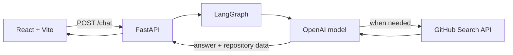

# Pramanix AI

[](LICENSE)


Pramanix is a student-focused AI assistant built with FastAPI, LangGraph, and
OpenAI. It answers general questions with a real language model and searches
public GitHub repositories when that helps.

## Features

- OpenAI tool calling decides when live GitHub search is useful.
- Repository names, links, descriptions, languages, stars, and update dates come
  from GitHub's Search API.
- A responsive React chat UI supports conversation context, loading and error
  states, retry, and repository cards.
- API input is bounded, CORS uses an explicit origin allowlist, and provider
  details are kept out of browser error responses.
- CI checks Python lint, formatting, strict types, offline tests, and the
  frontend production build.

## Architecture



The model answers general questions directly. For repository requests, it can
call the single read-only `github_search` tool. Repository details are returned
separately so the UI can render verified links and metadata.

## Run locally

Requires Python 3.11+, Node.js 20+, and an OpenAI API key.

```bash
git clone https://github.com/manthankro/pramanix.git
cd pramanix
python -m venv .venv && source .venv/bin/activate
pip install -e ".[dev]"
cp .env.example .env
```

Put your `OPENAI_API_KEY` in `.env`. The default model is `gpt-4.1-mini`. An
optional `GITHUB_TOKEN` raises the GitHub API rate limit. Keep both keys on the
server and never commit `.env`.

Start the API:

```bash
uvicorn app.main:app --reload
```

In another terminal, start the frontend:

```bash
cd frontend
npm ci
npm run dev
```

Open <http://localhost:5173>. The API docs are at <http://localhost:8000/docs>.
Set `VITE_API_BASE_URL` before building the frontend for deployment.

## API

`POST /chat` accepts a new message and optional previous turns:

```json
{
  "message": "Find beginner Python projects for a library system",
  "history": []
}
```

The response contains an assistant answer, the name of any tool actually used,
and structured repository results:

```json
{
  "response": "Here are a few repositories that may be useful...",
  "tool_used": "github_search",
  "repositories": [
    {
      "name": "owner/repository",
      "url": "https://github.com/owner/repository",
      "description": "A sample project",
      "language": "Python",
      "stars": 123,
      "updated_at": "2026-01-01T00:00:00Z"
    }
  ]
}
```

General answers return `tool_used: null` and an empty `repositories` array.
`GET /health` returns `{"status":"ok"}`.

## Configuration

| Variable | Required | Purpose |
| --- | --- | --- |
| `OPENAI_API_KEY` | Yes | Server-side model key |
| `OPENAI_MODEL` | No | Model name; defaults to `gpt-4.1-mini` |
| `GITHUB_TOKEN` | No | Optional token for higher GitHub search limits |
| `FRONTEND_ORIGINS` | No | Comma-separated allowed origins; defaults to `http://localhost:5173` |
| `VITE_API_BASE_URL` | No | Public API URL embedded in the frontend build |

## Docker

```bash
cp .env.example .env
# Set OPENAI_API_KEY in .env, then:
docker compose up --build
```

The Docker image does not include `.env`; Compose provides it at runtime.

## Quality checks

```bash
ruff check .
ruff format --check .
mypy app/
pytest
cd frontend && npm ci && npm run build
```

Tests mock model and GitHub calls, so CI does not need paid API access or secrets.

## Safety and deployment

- The only tool is a bounded, read-only GitHub search against a fixed API host.
- Treat repository metadata as untrusted. The assistant is instructed to ignore
  instructions found in tool output and not to execute repository code.
- Configure HTTPS, host-level rate limits, API billing alerts, and a privacy
  notice before exposing the service publicly.
- Configure production origins in `FRONTEND_ORIGINS`; CORS is not authentication.

## License

MIT, see [LICENSE](LICENSE).
